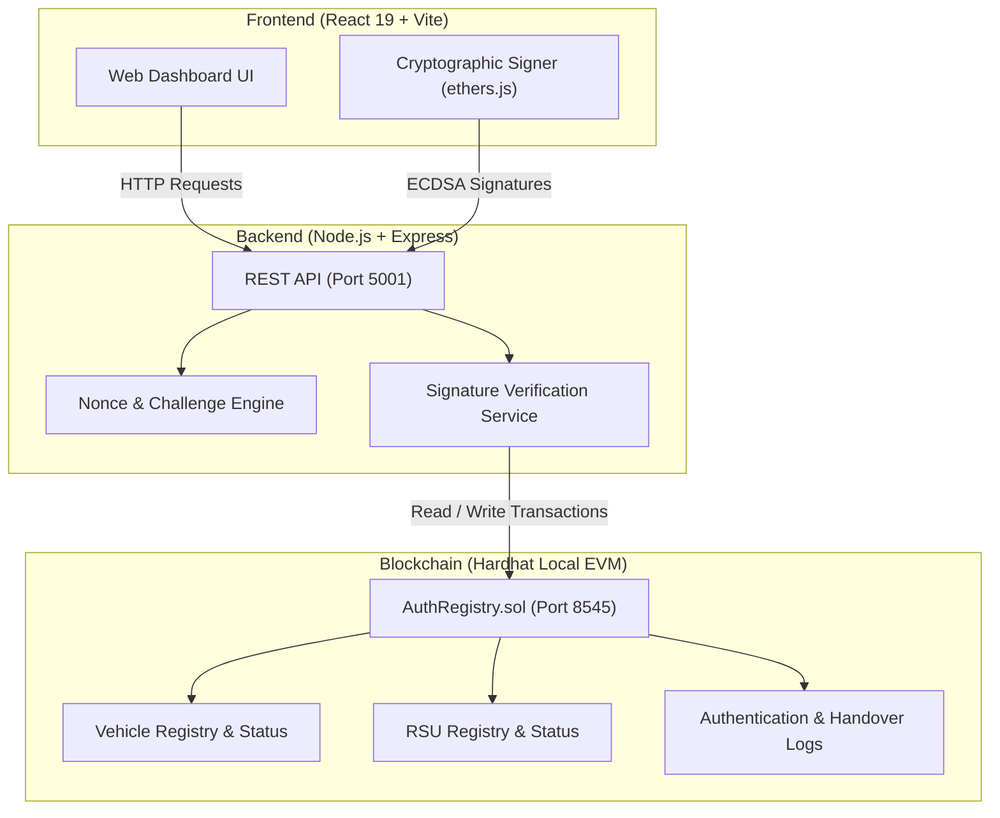

# V-CHAIN: Blockchain-Based Secure V2I Authentication & Handover Platform for VANETs

A decentralized security and mobility management platform for Vehicular Ad-Hoc Networks (VANETs), leveraging an Ethereum-compatible local blockchain and smart contracts for trust establishment, mutual authentication, seamless session handover, and real-time revocation.

---

## 1. Project Overview

**V-CHAIN** addresses security and privacy challenges in Vehicular Ad-Hoc Networks (VANETs). In traditional Intelligent Transportation Systems (ITS), vehicle-to-infrastructure (V2I) communication relies heavily on centralized Certificate Authorities (CAs). Centralized architectures introduce single points of failure, network bottlenecks, and high verification latency.

V-CHAIN replaces centralized trust with an immutable, smart-contract-governed identity layer. Using an Ethereum-compatible ledger, V-CHAIN enables two-way cryptographic mutual authentication between On-Board Units (OBUs) in vehicles and Roadside Units (RSUs), facilitates low-latency session handovers as vehicles move across coverage zones, provides instant revocation, and includes an interactive attack testing lab and real-time performance evaluation dashboard.

---

## 2. Problem Statement and Objectives

### Problem Statement
- **Centralized CA Vulnerability:** Centralized public-key infrastructures are vulnerable to single points of failure, distributed denial-of-service (DDoS) attacks, and network latency bottlenecks.
- **Mobility and Handover Delays:** Fast-moving vehicles crossing RSU coverage boundaries experience session drops and latency spikes if required to re-authenticate from scratch.
- **Identity Spoofing & Malicious Nodes:** VANETs face security threats including Sybil attacks, message replay, and cryptographic signature impersonation.

### Project Objectives
- Implement a decentralized trust root for vehicle and RSU identities using an Ethereum smart contract.
- Provide a two-way cryptographic challenge-response mutual authentication protocol using ECDSA (`secp256k1`) signatures.
- Enable fast session handover across adjacent RSUs using verifiable cryptographic handover tickets.
- Maintain an on-chain revocation center to instantly blacklist compromised vehicles.
- Develop an Attack Simulation Lab to empirically test and verify defenses against Sybil, impersonation, and replay attacks.
- Build a live Performance Dashboard to measure and benchmark real cryptographic and blockchain latencies.

---

## 3. Key Features

- **Decentralized Entity Registration:** Admin-governed on-chain enrollment and deactivation of vehicles and RSUs.
- **Two-Way Mutual Authentication:** Both the RSU and the vehicle cryptographically prove their identities before session authorization.
- **Cryptographic Session Handover:** Smooth transitions between RSUs via signed handover tickets without repeated heavy authentication.
- **Instant On-Chain Revocation:** Immediate blacklisting of malicious nodes recorded on the blockchain with audit reasons.
- **Dynamic Key Management:** Real-time inspection of active cryptographic keypairs, public key hashes, and security postures.
- **Interactive Attack Simulation Lab:** Demonstrates system defense against Unregistered Vehicle Access, Signature Impersonation, and Replay Attacks.
- **Live Performance Dashboard:** Real-time metrics for authentication latency, handover latency, gas consumption, and benchmark execution history.

---

## 4. Technology Stack

- **Blockchain & Smart Contracts:** Solidity (`^0.8.28`), Hardhat, Local EVM Node (Chain ID: `31337`)
- **Backend:** Node.js, Express.js, Ethers.js (`v6`), CORS, dotenv
- **Frontend:** React 19, Vite, Tailwind CSS, Lucide React, Recharts
- **Cryptography:** ECDSA (`secp256k1`), Keccak-256 hashing, cryptographic nonces

---

## 5. System Architecture



---

## 6. Project Setup and Installation

### Prerequisites
- Node.js (v18.x or higher)
- npm (v9.x or higher)
- Git

### Installation Steps

1. **Clone the repository:**
   ```bash
   git clone https://github.com/BhaskarChhabra/BlockChain.git
   cd BlockChain
   ```

2. **Install Blockchain dependencies:**
   ```bash
   cd blockchain
   npm install
   ```

3. **Install Backend dependencies:**
   ```bash
   cd ../backend
   npm install
   ```

4. **Install Frontend dependencies:**
   ```bash
   cd ../frontend
   npm install
   ```

5. **Configure Backend Environment Variables:**
   Create a `.env` file inside the `backend` directory:
   ```bash
   cd ../backend
   cp .env.example .env
   ```
   Ensure `backend/.env` contains:
   ```env
   PORT=5001
   BLOCKCHAIN_RPC_URL=http://127.0.0.1:8545
   CONTRACT_ADDRESS=0x5FbDB2315678afecb367f032d93F642f64180aa3
   PRIVATE_KEY=<YOUR_HARDHAT_DEPLOYER_PRIVATE_KEY>
   ```

---

## 7. How to Run the Project

Run each service in a separate terminal window:

### Terminal 1: Start Hardhat Node & Deploy Contract
```bash
cd blockchain
npx hardhat node
```
In the same directory (or a secondary terminal), deploy the smart contract:
```bash
npx hardhat run scripts/deploy.js --network localhost
```

### Terminal 2: Start Backend Server
```bash
cd backend
node server.js
```
*Backend runs on `http://localhost:5001`.*

### Terminal 3: Start Frontend Client
```bash
cd frontend
npm run dev
```
*Frontend runs on `http://localhost:5173`.*

---

## 8. Main Application Modules

- **Vehicle Registration:** Enrolls vehicles on-chain by storing their Ethereum wallet address, VIN, and public key hash. Admin controls allow deactivating and reactivating vehicles as needed.
- **RSU Registration:** Registers fixed roadside units on the smart contract with unique identifiers, geographic locations, and cryptographic signing keys.
- **Mutual Authentication:** Executes a two-way challenge-response handshake. The RSU signs a unique nonce proving its identity to the vehicle; the vehicle verifies the RSU signature on-chain, signs the challenge, and submits it back. On successful verification, authentication is permanently recorded on-chain.
- **RSU Handover:** Enables a vehicle transitioning between RSUs (e.g., RSU-01 to RSU-02) to generate a signed handover authorization ticket. The backend validates session continuity and records the transition on the blockchain without requiring full re-registration.
- **Revocation Center:** Allows administrators to immediately revoke compromised or rogue vehicles with a specified reason. Revoked vehicles are permanently blocked by smart contract checks from initiating challenges, authenticating, or executing handovers.
- **Attack Lab:** An interactive testbed demonstrating defenses against three threat scenarios:
  - *Attack 1 (Unregistered Vehicle):* Rogue nodes without on-chain registration are rejected.
  - *Attack 2 (Signature Impersonation):* Forged or mismatched signatures fail cryptographic verification.
  - *Attack 3 (Replay Attack):* Re-using expired or previously captured challenges is blocked by dynamic nonces.
- **Performance Dashboard:** Benchmarks system performance using live empirical measurements. Tracks challenge generation latency, signature verification time, blockchain confirmation latency, and gas consumption, with an interactive multi-iteration benchmark runner and CSV export.

---

## 9. Limitations

- **Local Network Scope:** Currently tested and executed on a local Hardhat test network (`localhost:8545`); deployment to a public testnet (e.g., Sepolia) requires live gas funding and RPC configuration.
- **Simulated Hardware OBUs:** Vehicle on-board units and RSU hardware interfaces are emulated via software cryptographic keypairs rather than physical automotive microcontrollers (e.g., HSMs/TPMs).
- **Consensus Latency:** Blockchain transaction confirmation latency is dependent on block mining times, which are near-instantaneous in local test environments but variable on public distributed networks.

---

## 10. Future Scope

- **Integration with Real VANET Simulators:** Interfacing V-CHAIN with traffic and network simulators such as SUMO and OMNeT++ / Veins to evaluate performance under high vehicle density and real-world Doppler effects.
- **Layer-2 Rollups / Sidechains:** Migrating authentication and handover settlement transactions to Layer-2 rollups (e.g., Arbitrum, Optimism) or dedicated state channels to reduce gas costs and achieve sub-second finality.
- **Zero-Knowledge Identity Verification:** Incorporating zk-SNARKs to allow vehicles to prove authorized registration and valid credentials without disclosing their persistent wallet addresses, enhancing vehicular location privacy.
